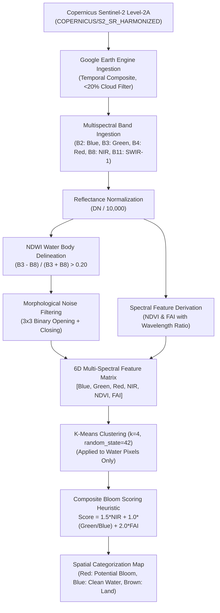
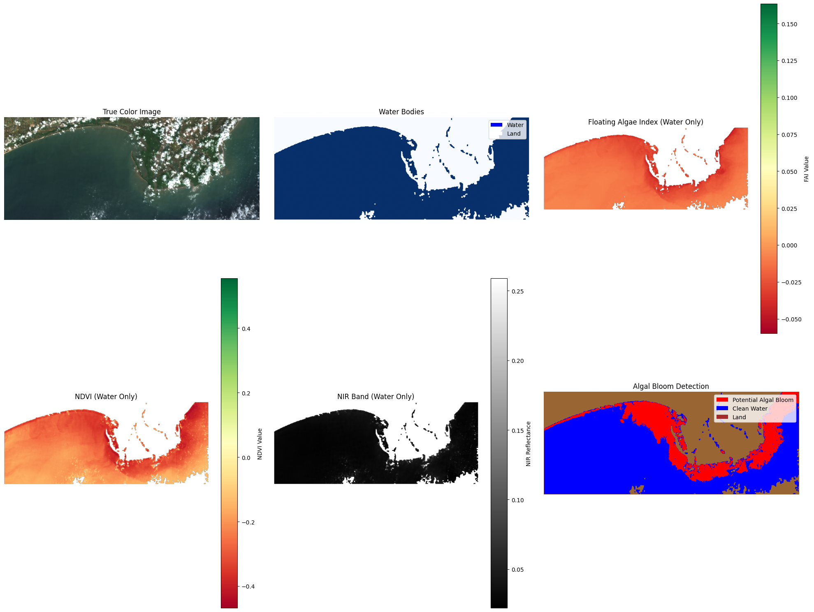

# Satellite Remote Sensing & Machine Learning for Exploratory Algal Bloom Mapping

[](https://www.python.org/)
[](https://sentinels.copernicus.eu/web/sentinel/missions/sentinel-2)
[](https://earthengine.google.com/)
[](LICENSE)

An unsupervised geospatial machine learning pipeline designed for **exploratory spatial mapping and anomaly delineation of potential algal blooms** across coastal and inland water bodies using multispectral imagery from the **European Space Agency (ESA) Copernicus Sentinel-2** constellation.

---

> [!IMPORTANT]
> **Scientific Scope & Ground-Truth Disclaimer:**  
> This project implements an **exploratory, unsupervised spectral anomaly mapping heuristic**. It clusters multi-spectral reflectance and ranks water regions based on an empirical bio-optical scoring heuristic. **It does NOT constitute scientifically validated or operational Harmful Algal Bloom (HAB) detection.** No in-situ microbiological sampling, taxonomic phytoplankton identification, or laboratory cyanotoxin assays (e.g. microcystin HPLC/ELISA) were conducted for this satellite scene. Consequently, **no claims of ground-truth detection accuracy, sensitivity, or specificity are made.**

---

## 1. Problem Statement & Motivation

Harmful Algal Blooms (HABs) occur when aquatic micro-organisms multiply rapidly under favorable nutrient and temperature conditions. Dense surface accumulations can induce localized hypoxia and release toxins that harm aquatic fauna and coastal water supplies.

While vessel-based water sampling provides definitive biological identification, it is geographically and temporally constrained. Satellite remote sensing offers wide-area synoptic coverage to flag anomalous surface reflectance signatures.

This repository provides an automated, reproducible workflow that:
- Queries surface reflectance imagery via **Google Earth Engine (GEE)**.
- Delineates surface water bodies using the **Normalized Difference Water Index (NDWI)** and binary mathematical morphology.
- Derives targeted aquatic spectral indices: **Normalized Difference Vegetation Index (NDVI)** and the **Floating Algae Index (FAI)**.
- Groups water pixels via **K-Means clustering ($k=4$)** and ranks them using an empirical **Bloom Likelihood Score**.
- Renders a 6-panel diagnostic map distinguishing potential bloom anomalies from clean water and land.

---

## 2. Technical Architecture & Verified Methodology



### 2.1 Spectral Bands & Exact Mathematical Formulations

All calculations adhere strictly to the original research notebook:

| Band Identifier | File Name | Nominal Central Wavelength ($\lambda$) | Purpose |
| :--- | :--- | :---: | :--- |
| **Band 2 (Blue)** | `sentinel2_B2.tif` | 490 nm | Multi-spectral feature vector, Green/Blue ratio baseline |
| **Band 3 (Green)** | `sentinel2_B3.tif` | 560 nm | NDWI calculation, Green/Blue chlorophyll ratio |
| **Band 4 (Red)** | `sentinel2_B4.tif` | 665 nm | NDVI, FAI baseline interpolation |
| **Band 8 (NIR)** | `sentinel2_B8.tif` | 842 nm | NDWI, NDVI, FAI peak scattering |
| **Band 11 (SWIR-1)** | `sentinel2_B11.tif`| 1610 nm | FAI baseline atmospheric correction |

*(Note: Band 12 / SWIR-2 at 2190 nm was downloaded in the initial GEE script but is omitted from downstream index calculations, matching the original notebook).*

1. **Surface Reflectance Conversion:**
   $$\rho_{\text{band}} = \frac{\text{Digital Number (DN)}}{10,000.0}$$

2. **Normalized Difference Water Index (NDWI):**
   $$\text{NDWI} = \frac{\rho_{\text{Green}} - \rho_{\text{NIR}}}{\rho_{\text{Green}} + \rho_{\text{NIR}}} = \frac{B3 - B8}{B3 + B8}$$
   Water pixels are identified where $\text{NDWI} > 0.20$.

3. **Mathematical Morphology Filtering:**
   Initial water mask is cleaned using `scipy.ndimage`:
   - Binary opening with a $3 \times 3$ all-ones structuring element (removes speckle noise).
   - Binary closing with a $3 \times 3$ all-ones structuring element (bridges internal discontinuities).

4. **Normalized Difference Vegetation Index (NDVI):**
   $$\text{NDVI} = \frac{\rho_{\text{NIR}} - \rho_{\text{Red}}}{\rho_{\text{NIR}} + \rho_{\text{Red}}} = \frac{B8 - B4}{B8 + B4}$$

5. **Floating Algae Index (FAI):**
   Derived following Hu (2009) using linear baseline interpolation between Red and SWIR-1:
   $$\text{Ratio} = \frac{\lambda_{\text{NIR}} - \lambda_{\text{Red}}}{\lambda_{\text{SWIR}} - \lambda_{\text{Red}}} = \frac{842 - 665}{1610 - 665} = \frac{177}{945} \approx 0.187302$$
   $$\text{Baseline}_{\text{NIR}} = \rho_{\text{Red}} + (\rho_{\text{SWIR}} - \rho_{\text{Red}}) \times \text{Ratio}$$
   $$\text{FAI} = \rho_{\text{NIR}} - \text{Baseline}_{\text{NIR}}$$

6. **K-Means Clustering & Heuristic Bloom Scoring:**
   - Feature array: $[\rho_{\text{Blue}}, \rho_{\text{Green}}, \rho_{\text{Red}}, \rho_{\text{NIR}}, \text{NDVI}, \text{FAI}] \in \mathbb{R}^6$ across all valid water pixels.
   - Clustering: `KMeans(n_clusters=4, random_state=42)`.
   - Cluster centroid ranking heuristic:
     $$\text{Bloom Score}_k = 1.5 \cdot \bar{x}_{\text{NIR}} + 1.0 \cdot \left(\frac{\bar{x}_{\text{Green}}}{\bar{x}_{\text{Blue}} + 10^{-6}}\right) + 2.0 \cdot \bar{x}_{\text{FAI}}$$
   - The cluster maximizing this score is mapped to **Potential Algal Bloom**.

---

## 3. Results & Visual Diagnostics

The pipeline was executed on a Sentinel-2 scene over coastal waters (Bay of Bengal / Andhra Pradesh coast). The verified output generated by the notebook execution is shown below:



### Verified Cluster Diagnostics from Notebook Run ($k=4$)

| Cluster ID | NIR Reflectance | Green/Blue Ratio | FAI Value | Composite Bloom Score | Cluster Interpretation |
| :---: | :---: | :---: | :---: | :---: | :--- |
| **Cluster 0** | 0.0308 | 1.0930 | -0.0163 | 1.1066 | Clean Water |
| **Cluster 1** | **0.0359** | **1.1720** | **-0.0278** | **1.1702** | **Potential Bloom Anomaly (Highest Score)** |
| **Cluster 2** | 0.0917 | 1.0598 | -0.0225 | 1.1525 | Intermediate Turbidity |
| **Cluster 3** | 0.0304 | 0.9763 | -0.0095 | 1.0030 | Deep Clear Water |

*Floating Algae Index (FAI) Statistics on Water Pixels:*
- **Minimum FAI:** `-0.0598`
- **Maximum FAI:** `0.4522`
- **Mean FAI:** `0.0245`

---

## 4. Comparison with Original Notebook & Newly Introduced Functionality

This repository preserves the scientific logic of the original exploratory notebook while restructuring it into a clean, modular Python codebase:

| Component | Original Notebook (`BDA (1).ipynb`) | Modular Implementation (`src/algal_bloom/`) | Status |
| :--- | :--- | :--- | :---: |
| **Mathematical Formulas & Bands** | Hardcoded in cell 8 | Encapsulated in `indices.py` | **Faithful** |
| **Water Masking & Morphology** | Cell 8 (`scipy.ndimage`) | Encapsulated in `water_mask.py` | **Faithful** |
| **K-Means & Scoring Formula** | Cell 8 ($k=4$, `random_state=42`) | Encapsulated in `clustering.py` | **Faithful** |
| **Visualization Layout & Palette**| Cell 8 Matplotlib 6-panel plot | Encapsulated in `visualization.py` | **Faithful** |
| **GEE Project ID Credential** | Hardcoded string (`algalbloom-492206`)| Parameterized via `GEE_PROJECT_ID` env var | **Enhanced** |
| **Package Architecture** | Single monolithic script | Modular package (`src/algal_bloom/`) | **New Feature** |
| **Object-Oriented Pipeline** | None | `AlgalBloomDetector` class in `pipeline.py` | **New Feature** |
| **CLI Runner** | None | `src/main.py` with argument parsing | **New Feature** |
| **Spatial Tiling Engine** | Basic cell function | `GEECollector` class in `gee_collector.py` | **New Feature** |
| **Clean Notebook** | Leaflet widget bloat (>130 KB) | Clean notebook in `notebooks/` | **Enhanced** |

---

## 5. Repository Structure

```
algal-bloom-detection/
├── README.md                           # Documentation & verified results
├── requirements.txt                    # Pinned Python package dependencies
├── .gitignore                          # Exclusion rules for GeoTIFFs & caches
│
├── notebooks/
│   └── algal_bloom_analysis.ipynb      # Cleaned interactive analysis notebook
│
├── src/
│   ├── main.py                         # CLI entry point for batch processing
│   └── algal_bloom/
│       ├── __init__.py                 # Package exports
│       ├── indices.py                  # NDWI, NDVI, and FAI computations
│       ├── water_mask.py               # NDWI thresholding & morphological filtering
│       ├── clustering.py               # K-Means clustering & cluster ranking
│       ├── visualization.py            # 6-panel publication plotting
│       ├── gee_collector.py            # Parameterized GEE image retrieval & tiler
│       └── pipeline.py                 # High-level AlgalBloomDetector class
│
├── data/
│   └── README.md                       # Data acquisition & Sentinel-2 band guide
│
├── outputs/
│   └── algal_bloom_detection_results.png # 6-panel output extracted from notebook
│
└── docs/
    └── methodology.md                  # In-depth mathematical and remote sensing theory
```

---

## 6. Execution Guide

### 6.1 Prerequisites & Installation

```bash
git clone https://github.com/vasanth-09ux/algal-bloom-detection.git
cd algal-bloom-detection

python -m venv .venv
# On Windows:
.venv\Scripts\activate
# On Linux/macOS:
source .venv/bin/activate

pip install -r requirements.txt
```

### 6.2 Sourcing Sentinel-2 Imagery

Set your Google Cloud Project with the Earth Engine API enabled:

```bash
export GEE_PROJECT_ID="your-gcp-project-id"
```

Or run the interactive notebook `notebooks/algal_bloom_analysis.ipynb`.

### 6.3 Executing Detection via CLI

Once GeoTIFF bands (`sentinel2_B2.tif`, `B3`, `B4`, `B8`, `B11`) are placed in `data/`:

```bash
python src/main.py --data-dir data --output-plot outputs/detection_output.png --ndwi-threshold 0.2 --clusters 4
```

---

## 7. Limitations & Scientific Boundaries

1. **Absence of Ground Truth:** This pipeline is an unsupervised clustering tool. It groups statistically distinct spectral signatures. Without contemporaneous in-situ water sampling, it cannot confirm whether a flagged anomaly is a toxic cyanobacteria bloom, non-toxic green algae, or suspended organic detritus.
2. **Surface Sensitivity Only:** The FAI and NIR channels measure surface floating scums. Submerged biomass located deeper than $\sim 2\text{ meters}$ is obscured by strong water absorption in the NIR and SWIR wavelengths.
3. **Turbidity Confounding:** Highly turbid waters with inorganic suspended sediments can elevate NIR reflectance and distort the green/blue ratio, which may lead to false positives if not cross-referenced with salinity or turbidity indices.

---

## 8. References

1. **Hu, C.** (2009). *A novel ocean color index to detect floating algae in the global oceans.* Remote Sensing of Environment, 113(10), 2118-2129.
2. **McFeeters, S. K.** (1996). *The use of the Normalized Difference Water Index (NDWI) in the delineation of open water features.* International Journal of Remote Sensing, 17(7), 1425-1432.
3. **Rouse, J. W., et al.** (1974). *Monitoring the vernal advancement and retrogradation (green wave effect) of natural vegetation.* NASA/GSFC Final Report.
4. **Drusch, M., et al.** (2012). *Sentinel-2: ESA's optical high-resolution mission for GMES operational services.* Remote Sensing of Environment, 120, 25-36.

---

## 9. Author

**Vasanth**  
*Integrated M.Tech in Software Engineering, Vellore Institute of Technology (VIT), Chennai*  
*AWS Certified Solutions Architect – Associate*  
GitHub: [@vasanth-09ux](https://github.com/vasanth-09ux)
